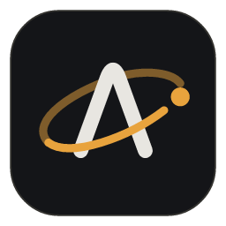
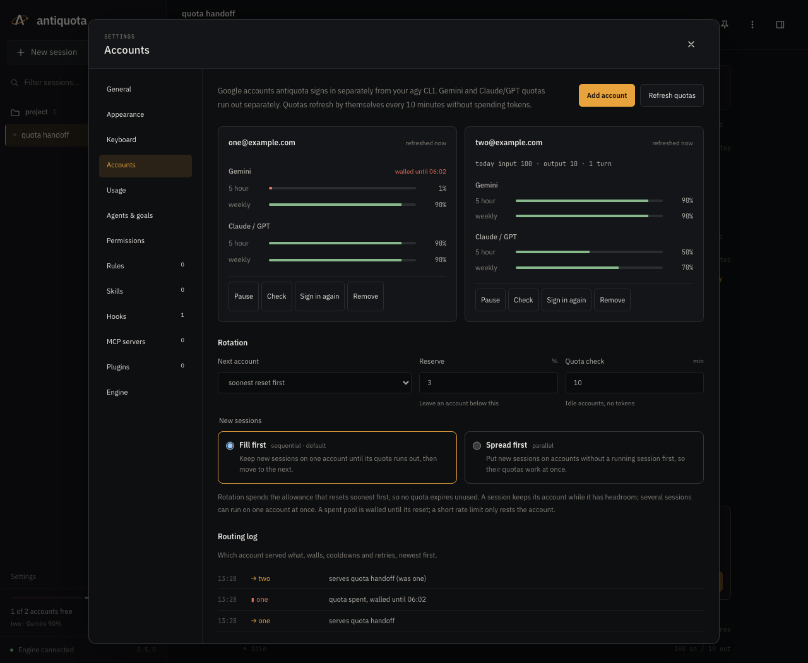
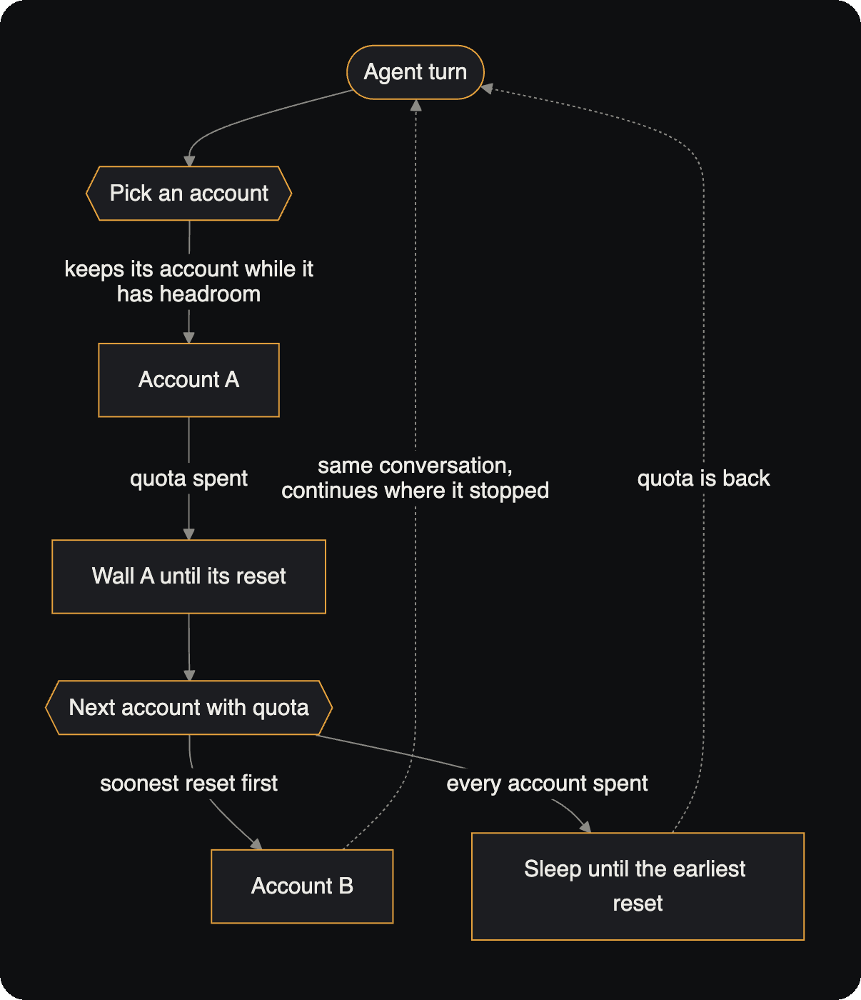
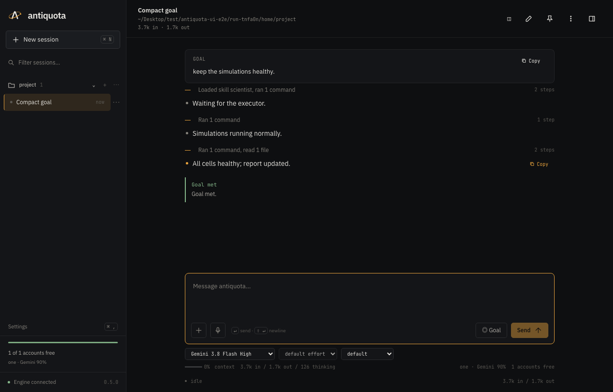
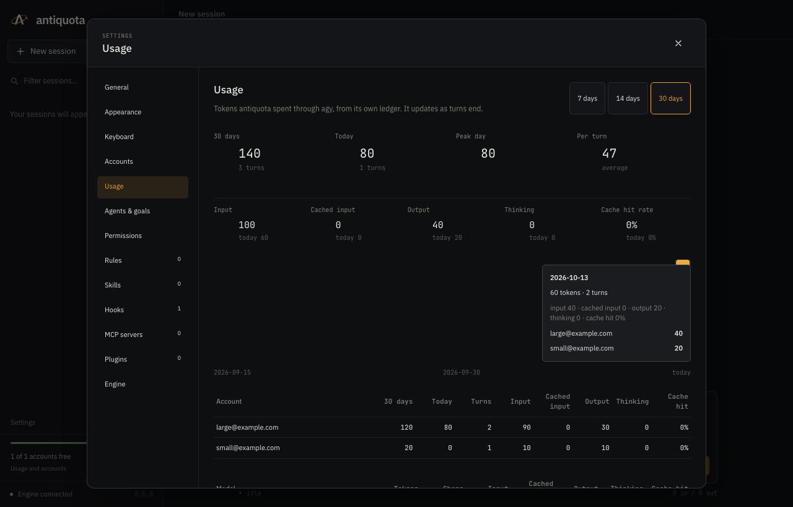

<div align="center">



# antiquota

**Keep your coding agent working around the clock across all your Google AI Pro accounts.**

antiquota runs Google's Antigravity CLI (`agy`) across every Google account you have. When one account
runs out of quota, the same conversation continues on the next one, with no lost context and no babysitting.


</div>

---

## Why

AI Pro promotions have left many people with several Google accounts: a student offer here, an
18-month carrier deal (such as Jio's) there, a family member's spare seat. Each account has its own
**5-hour and weekly quota**. A long agent run burns through one in a few hours, then stops and waits.

antiquota treats those accounts as a single pool:

- **One account is tired, the next one takes over.** A spent quota walls that account until it resets.
  The turn continues in **the same agy conversation** on the next account that has headroom.
- **Nothing expires unused.** By default it spends the allowance that resets soonest first.
- **Agents run 24/7.** Give a session a goal and it keeps working through the night. When every
  account is spent, it sleeps until the earliest reset and carries on by itself.

> With enough accounts, the agent never waits for quota.

<p align="center">
  
  <br><sub>One account spent its 5-hour quota and is walled until 06:02. The next account picked up the
  same session, and the routing log records the handoff.</sub>
</p>

## How account switching works

<p align="center">
  
</p>

- **Quota-aware routing.** Each account's Gemini and Claude/GPT pools are tracked separately from agy's own
  quota panel. Readings refresh every 10 minutes and cost no tokens, even while agents work.
- **Rotation you choose:** *soonest reset first* (default), *one by one*, or *round robin*. A small reserve
  (3% by default) moves a session on before it fails mid-turn.
- **Fill first or spread first.** Stack sessions on one account until it runs out, or spread them across
  accounts so their quotas work in parallel. Several sessions can share one account.
- **Errors are told apart.** A spent quota walls an account until its reset. A rate limit while quota
  remains only rests it (1, 5, then 15 minutes). Temporary errors retry, then move on. A rejected sign-in
  parks the account until you sign in again.
- **Survives network drops.** If Wi-Fi goes away, sessions show *waiting for network* and pick the same
  turn back up when it returns. No account is blamed and no retry is wasted.
- **Every decision is logged:** which account served what, walls, rests and retries.

All accounts share one conversation store, so a handoff is a real continuation, not a restart from a
summary. Only when a conversation truly cannot be resumed does antiquota start a fresh one, with its own
handoff summary in front of the next message.

## Run an agent all night

**Goal mode** keeps an agent working until the job is really done:

1. You state an objective and, optionally, a check command (`go test ./...`, `pytest -q`).
2. The agent works and claims completion only when it believes the objective is met.
3. The check command must pass, **and** an independent verifier (a fresh, read-only agy conversation) must
   agree. Otherwise the reasons go back to the agent as its next prompt.
4. Long jobs (training, big test suites) run in the background. The agent gets their log when they finish.

Combine goals with account switching and a few accounts become one agent that keeps going for days.
Two sessions can also hand work to each other through a shared file, for example one that plans and audits
and one that builds.

<p align="center">
  
  <br><sub>The compact transcript (the default) shows a goal as prompt, text, folded activity and outcome.
  Verbose and Full show every step.</sub>
</p>

## Everything else you'd expect

| | |
|---|---|
| **Sessions** | Many sessions in parallel, per project folder; split view; search; fork, rewind, compact |
| **Transcript** | Streamed replies with Markdown and code highlighting, thinking, tool previews; compact, verbose and full modes |
| **Safety** | A permission policy decides every tool call; approvals appear in the app; plan mode only proposes |
| **Git** | A separate git worktree per session; review, commit and merge from the Changes panel |
| **Usage** | Tokens per day, per account and per model, including cached input and cache hit rate |
| **Composer** | `@file` mentions, attachments, dictation, `!shell`, `# note`, slash commands, prompt history |
| **Background work** | `RUN_IN_BACKGROUND` jobs, `/loop`, daily `/schedule`, a terminal per session, keep-awake |
| **Desktop app** | Native app with tray, notifications, dock badge and the system folder picker (Finder, Explorer, or your Linux desktop's) |
| **CLI** | `antiquota -i` for a terminal session that the app shows live; headless `antiquota goal` |

<p align="center">
  
</p>

## Getting started

**You need:** the Antigravity CLI (`agy`) installed, and one or more Google accounts with AI Pro.

1. **Install the app.** Download the latest release for your platform, or build it from source (below).
   - macOS (Apple Silicon): open the `.dmg` and drag Antiquota to Applications. Builds are not notarized, so
     the first launch needs right-click → **Open**.
   - Linux: install the `.deb` or `.rpm`, or run the `.AppImage`.
   - Windows: run the `.msi` or `-setup.exe` installer. SmartScreen warns about unsigned builds.
2. **Add your accounts.** In *Settings → Accounts* choose **Add account** and sign in with Google. Repeat for
   every account. Accounts are listed by email, each with its 5-hour and weekly quota.
3. **Start a session** in a project folder and send a prompt, or press **Goal** to give it an objective.
4. Leave it running. The routing log shows each handoff.

> antiquota keeps its own copy of your agy configuration (rules, skills, hooks, MCP servers). Your agy CLI and
> the Antigravity IDE are never changed.

### Terminal

```sh
antiquota -i                        # interactive session, shared live with the app
antiquota -i --resume SESSION_ID    # continue a saved session
antiquota goal "all tests pass" --check "pytest -q" --cwd ~/code/app
antiquota login                     # add a Google account
antiquota accounts                  # quota, walls and leases per account
```

See [docs/CLI.md](docs/CLI.md) for every command and slash command.

## Platform support

| Platform | Status |
|---|---|
| **macOS** (Apple Silicon) | Built, tested and used daily |
| **Linux** (x86_64, arm64) | Supported in the code and installers: tray, keep-awake through `systemd-inhibit`, native folder picker. Not yet tested on real machines |
| **Windows** (x86_64) | Supported in the code: tray, keep-awake, job objects for process cleanup, Explorer folder picker. Not yet tested on real machines |

Reports from Windows and Linux are very welcome. Please open an issue with what worked and what did not.

## How accounts stay separate

```
~/.antiquota/
  stack/.gemini/     antiquota's copy of your agy setup: rules, skills, hooks, MCP, plugins
  slots/<email>/     one home folder per account; its sign-in token is a file inside it
  sessions/<id>/     one session: metadata and its full event history
  state/             quota readings, walls, leases, the routing log and usage ledger
```

agy normally keeps its token in the OS keyring, where a second account would overwrite the first. antiquota
gives every account its own home folder and has agy store its token as a file there, so accounts never
collide and your own agy sign-in is left alone. All slots link the same conversation store, which is what
lets a turn continue on another account.

The engine listens on `127.0.0.1` only, and every API call needs the install's token.

## Build from source

Requirements: Rust 1.99+, Node 26 with pnpm 11, and [`just`](https://github.com/casey/just).
On Linux, also the webview libraries:
`libwebkit2gtk-4.1-dev libappindicator3-dev librsvg2-dev patchelf`.
On Windows, the Microsoft C++ build tools and WebView2 (preinstalled on Windows 11). Run `just` from Git Bash, since the build scripts are POSIX shell.

Installers are built on the platform they are for: build a macOS `.dmg` on a Mac, Linux packages on Linux and
Windows installers on Windows.

```sh
pnpm --dir ui install --frozen-lockfile
just build           # bundled engine + desktop app: .dmg (macOS), .deb/.rpm/.AppImage (Linux), .msi/.exe (Windows)
just dev             # engine and UI in development mode
just check           # formatting, clippy, cargo-deny, type checks, lint
just test            # Rust tests, Vitest, then Playwright end-to-end tests
```

Every test runs against a fake agy with synthetic accounts: no real account or quota is needed.
[docs/ARCHITECTURE.md](docs/ARCHITECTURE.md) describes the layers, and `docs/adr/` records every design decision.

## A note on accounts

antiquota only automates accounts you sign in to yourself, on your own machine. It does not create accounts,
share tokens or bypass any limit on a single account: each account is used within its own quota. Use accounts
you own or are allowed to use, and follow the terms of the services involved.

## License

[MIT](Cargo.toml)
