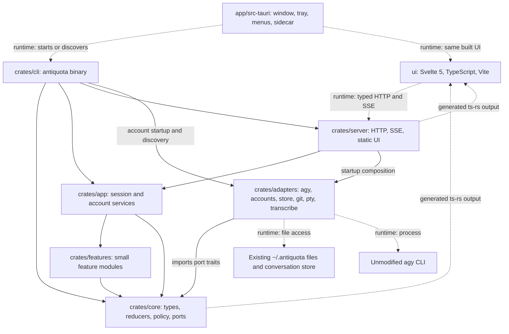

# antiquota architecture

This document defines the Rust and TypeScript rewrite. It is an implementation contract, not a claim of completed parity. The Python app remains runnable on `main`; implementation and evidence belong to the `rust` worktree. The acceptance baseline is [1,144 feature items](rewrite/FEATURES.md), [75 captured API routes](rewrite/API_CONTRACT.md), [existing data formats](rewrite/DATA_FORMATS.md), and the [regression ledger](rewrite/known-bugs.md). Every item remains pending until its named tests pass.

## Dependencies and ownership

Solid edges show Rust crate imports. Dashed edges show labeled runtime connections or generated output, not imports. Dependencies point toward the domain. Core never imports Tokio, filesystem APIs, process APIs, HTTP, or shell APIs. Features depend on core and return decisions; application services execute those decisions through ports. App imports no concrete adapter. Adapters do not call feature modules or HTTP handlers. Server handlers translate transport inputs and delegate to application services. CLI owns executable startup; server startup owns HTTP-runtime composition and supplies concrete adapters through app's core ports. Discovery file access remains at those executable/runtime boundaries.

| Location | Owns |
| --- | --- |
| `crates/core` | `Session`, `Turn`, one `Event` enum, `Command`, `Account`, `Slot`, `Quota`, `Goal`, `Approval`, `Rule`, `Settings`; pure reducers; routing and permission decisions; port traits. |
| `crates/features` | `Feature` hooks and separate modules for goals, verifier, plan, loop, schedule, jobs, handoff, steering, fork, and keep-awake. |
| `crates/app` | Account-only maintenance and session command serialization, turn execution, cancellation, subscriptions, approvals, scheduling, and projections through injected core ports. Split these responsibilities into modules; no engine god object. |
| `crates/adapters/agy` | agy arguments, process lifetime, bounded stream-json decoding, stderr/error classification inputs, and conversation-step parsing. |
| `crates/adapters/accounts` | Slot paths, leases, account HOME and file-token isolation, sign-in, quota/model probes, and owned configuration links. |
| `crates/adapters/store` | Existing JSON/JSONL files, atomic snapshots, append-only event records, checkpoints, attachments, and read-only conversation database access. |
| `crates/adapters/git` | Explicit `git` argument lists, status/diffs, worktree creation, commit, merge, and removal. |
| `crates/adapters/pty` | Portable PTY/ConPTY lifecycle, input, resize, output, and safe process-tree cleanup. Project-owned unsafe code is allowed only here. |
| `crates/adapters/transcribe` | Temporary audio, an isolated agy call using Flash High, NO_SPEECH handling, and cleanup. |
| `crates/server` | HTTP-runtime startup composition, captured HTTP routes, Host/token checks, body limits, JSON errors, SSE encoding, and built UI serving. Handlers use application commands; startup alone chooses concrete adapters. |
| `crates/cli` | One clap binary, legacy commands, `serve`, and the fast `hook` entry point. `anyhow` is confined to executables. |
| `ui/src/lib` | Generated-type API client, one event connection, pure reducers, view stores, formatting, and platform actions. |
| `ui/src/components` | Focused views/widgets subscribed to stores; no direct fetch or engine policy. |
| `app/src-tauri` | Discovery and sidecar supervision, native window state/zoom, tray, menus, notifications, and autostart. |

Each source module states its ownership in a doc comment. Keep modules and components below about 400 lines. Library errors use `thiserror`; boundary logging uses `tracing`. Public data uses `serde`. Avoid registries, dependency injection containers, plugin loaders, and a second internal event bus.

## Ports and feature hooks

Core declares `AgentRunner`, `AccountStore`, `QuotaProbe`, `SessionStore`, `Vcs`, `Pty`, `Transcriber`, `Clock`, and `Notifier`. A port exposes the smallest operations used by its service, domain input/output types, and a typed error. Runtime handles and adapter details remain behind that boundary. No Tokio types cross into core. A synchronous or standard-library future signature is chosen for each concrete operation; adapters may use Tokio internally. Do not introduce a universal request/response port.

`AgentRunner` executes an owned turn request, reports typed events, and supports cancellation. `AccountStore` acquires an owned account lease and provides the selected slot context; only the adapter constructs environment variables or reads credentials. `SessionStore` loads snapshots/records, appends records, and atomically replaces snapshots. `Clock` supplies time and local-calendar conversion needed by decisions; runtime waiting happens in app, with a fake clock in tests. `Notifier` receives explicit user notification data and has a harmless CLI/browser implementation.

The small `Feature` trait has `before_turn`, `on_event`, and `after_turn` hooks. Hooks inspect a session/turn view and return ordinary `Command` values or a typed refusal. They do not spawn processes, write files, subscribe independently, or mutate shared session state. App executes returned commands through the same command dispatcher. A feature can request a follow-up turn, a verifier call, a job, an account handoff, or a wake-state change without owning the runtime. Keep-awake computes whether active turns/jobs require a hold; app owns one safe platform handle and releases it on shutdown. A safe platform library avoids new unsafe code outside the PTY adapter.

The feature list is explicit in application wiring. A new feature adds one module and one composition entry, not branches throughout session execution. Hook order is fixed and tested: permission/plan restrictions precede effects; steering prepares the prompt; handoff selects continuation; goal/verifier/loop follow-ups happen after the completed turn. No feature may recursively dispatch its own commands during a hook.

## Commands, events, and recovery

HTTP, CLI, native menus, and approval answers use the same application commands. One worker serializes mutation for each session. A short registry lock locates a worker; it never covers process waits, account probing, SSE writes, or file reads. Stop and approval answers have a control path that can interrupt a waiting turn. One account lease prevents simultaneous use or refresh of its HOME.

Core owns one `Event` enum, using the captured `t` discriminant and existing event variants. An event record adds numeric `ts`; server streaming adds the existing nullable `sid`. These are Rust types exported to TypeScript. There is no new public version wrapper, sequence field, or event-name protocol. Ordering is the append order of records for a session; runtime sequence positions can be derived from that order.

For durable events, the flow is command validation, pure transition, event append, in-memory reduction, atomic snapshot, and publication. Observable completed state never precedes its durable record. The application publishes the same typed event it records. Transient deltas use the same enum and stream but are not written to disk. Transcript queries project the same durable transcript subset as the captured Python API. Metadata and control events needed for recovery are retained in the session log without appearing as duplicate transcript rows.

The store reads today's flat `events.jsonl` records unchanged and preserves unknown event fields. It does not normalize or rewrite the old log. Recovery selects the latest complete metadata event as its state boundary when present and reduces only the subsequent tail. If none exists, the legacy `meta.json` is authoritative; old transcript rows project history without adding their usage to that snapshot again. The first Rust-owned metadata record establishes the boundary for later recovery. New sessions start with a metadata record, and every accepted metadata change records its result. Tests interrupt between append, reduction, and snapshot replacement.

Account usage is an idempotent projection into the existing `state/usage.jsonl`, with no new fields or file. For each Rust-owned completed turn after that session's first Rust metadata boundary, the ledger's existing `t` copies the exact durable `turn_end.ts`. Allocate that instant uniquely per session against both event and ledger timestamps; a fixed-clock tie advances to the next representable finite instant without advancing the scheduler clock. Under one global writer mutex, reconciliation checks `(session, t)` and appends a missing row once. Never deduplicate legacy rows or equal token/model tuples: the captured ledger contains legitimate identical rows. Preserve every legacy row verbatim, diagnose incomplete append lines, and test crashes before/after event and ledger append, equal-token fixed-clock turns, backward wall time, and restart. Flush pending usage before deleting a session; its historical ledger rows remain.

Clear keeps the transcript and starts a fresh conversation, as the existing engine does. Compact keeps the transcript and supplies a handoff summary. Rewind appends its existing notice and updates files/checkpoints; it does not truncate the event log. Explicit session deletion removes only that session's owned data after stopping its processes. An incomplete final JSONL line is retained and diagnosed; recovery must never silently delete a valid earlier record or append new JSON into a damaged line.

SSE retains `data: <json>\n\n` and idle comments. No new replay cursor is promised by the captured API. A slow client is disconnected rather than silently losing events; it reconnects and refreshes `/api/state` and the selected session. Server failure is a typed error and a useful log entry, not an HTTP connection drop without explanation.

## Existing files and account continuity

The store preserves the layout and semantics in [DATA_FORMATS.md](rewrite/DATA_FORMATS.md). Known fields use typed structs; flattened `serde_json::Value` maps retain unknown keys and numeric values on read/write. Enable serde_json's `arbitrary_precision` for exact opaque-number retention and test integers/decimals beyond ordinary floating-point precision. Updates merge known fields into the stored object; they never round-trip opaque extensions through JavaScript numbers. Legacy absent keys receive fresh per-instance defaults. Nested goal, job, settings, and worktree objects also preserve extensions. Settings retain their existing string-valued storage. Credential files remain opaque bytes owned and refreshed by agy; they never enter events, fixtures, or logs.

Use the existing data root, engine discovery file, token, per-account lease files, stack, and conversation store link. Acquire the engine lock before recovery and publish `engine.json` only after health is ready. Prove lock interoperability with the Python engine on each platform; standard-library file locking is preferred where its behavior matches. Never run Python and Rust writers against one root at once. Side-by-side development uses isolated roots and ports, while each CLI/GUI pair discovers its own shared engine.

The local token-preserving backup is documented in DATA_FORMATS.md. Before first authorized live access, verify all five identities, token modes, symlinks, and session counts against private continuity evidence. No migration, credential rotation, renamed layout, or destructive cutover is implicit. Restore only with all engine writers stopped and only after preserving work created since the backup.

## HTTP and generated TypeScript

The captured routes, response nulls, field names, limits, authentication rules, and error statuses remain the contract. Group handlers by sessions, accounts, approvals, settings, files/git, jobs/schedule, terminal, and transcription. Each handler converts a typed Rust request into an application command and converts the result into the captured response. Health/static handlers remain separate. Tests replay the recorded preparation and request order; broad snapshot exclusions are forbidden. The CLI dispatches `hook` before full runtime/configuration startup so permission checks start in milliseconds and only contact the discovered engine or apply conservative fallback policy.

API-specific request and response types live in server; reusable session/events/settings types live in core. Both derive `TS`. A server example or small executable exports the root response/request types and their dependencies to `ui/src/gen/` with `TS::export_all(&Config)`. It also emits a deterministic Rust-owned HTTP method/path catalog for the client. UI components import only these generated API types. TypeScript may declare view-only state, but never copies request or response interfaces.

Use ts-rs 12.0.1 with `serde-compat` and `serde-json-impl`. Its published source generates recursive `JsonValue` for `serde_json::Value`, without a TypeScript `any`. Set `TS_RS_LARGE_INT=number` because the existing JSON contract uses numbers, and validate public counters within JavaScript's safe integer range. `Config` sets an explicit output directory; generation does not depend on the current working directory. `just gen-types` regenerates files. A separate stale check generates into a temporary directory and compares file names and bytes, failing on missing, changed, or extra generated files without repairing the checkout.

There is one `ui/src/lib/api.ts` client for JSON, raw uploads, attachments, and terminal input. It applies token/error/body rules and returns generated types. One event store owns EventSource and parses each message through a narrow validation boundary. Pure event reducers update session, transcript, account, and approval stores. Components call client functions or store actions and never `fetch` directly.

## UI and native shell

Build a Svelte 5 SPA with strict TypeScript and Vite; no SvelteKit server is needed. Svelte stores hold cross-view state and pure reducers remain independently testable. Keep current dense warm styling. One CSS token file defines dark/light colors, spacing, typography, and focus. Browser and native shells use the same production build; a platform module exposes only native capabilities and their browser fallbacks.

Split view contains two session components subscribed to the same stores and event connection. Session-specific input, selection, scroll, and terminal state are keyed by session id. There is no iframe with duplicated global state or second root zoom. Use xterm.js plus its fit addon, Chart.js, and MediaRecorder directly. Their instances belong to focused widgets and are disposed on unmount.

Tauri bundles the `antiquota` sidecar and discovers existing engines through `engine.json`. The shell retains the same tray/menu behavior and owns notifications/autostart. Native zoom uses `getCurrentWebview().setZoom`; it never sets CSS root zoom. Browser zoom stays under browser control. Window-state saves SIZE, POSITION, and MAXIMIZED only. Validate the final restored rectangle against available monitors after applying saved size; center an off-screen rectangle without revealing a `--hidden` launch.

## Slice 1 agreement

Slice 1 proves session creation, loading, selection, one agy turn, streaming, stop, and restart through CLI, HTTP, and UI. It uses an isolated signed-in fake account and fake-agy under `~/Desktop/test`; no real paid call is needed. Minimal account lease/HOME preparation is required here to run safely; full sign-in, quota ranking, and handoff remain Slice 2. Before any protected real agy launch, preflight the owned config's denying hook: it must be present, enabled, executable, and demonstrably refuse a known-denied call. A missing, disabled, or unusable gate refuses launch. While full approvals await Slice 3, ask/unknown/unavailable-engine/timeouts deny; never add an unguarded skip-permissions runner.

Implement core types/reducers/ports first, store/account-context/agy adapters next, app services next, then session HTTP handlers and the generated type exporter. The backend and UI agree on generated types before UI implementation begins. The UI starts with shell, project/session list, transcript, composer, status, and error/stop states. Features not yet implemented remain pending in the ledger; returning a placeholder success is forbidden.

Slice 1's initial captured route subset is health, `GET /api/state` for the session list, `POST /api/sessions` for creation, session get/update/send/stop/delete, and global events. The legacy contract has no `GET /api/sessions` route. `serve` retains root/token bootstrap, port selection, engine lock/discovery, and graceful shutdown. All 75 routes are delivered by their owning slices; temporary gaps remain explicit 404s with pending ledger items, never placeholder successes. The generated route catalog distinguishes implemented routes from pending legacy routes. CLI `run` and session-backed execution consume the same events. The final command surface retains every inventoried legacy command plus `hook`.

Slice 1 passes pure reducer/store replay tests, adapter parsing/cancellation tests, a fake-agy whole-server turn, captured session transport/security cases, TypeScript API/reducer tests, and a Chromium create/send/stream/relaunch scenario. Compare its evidence with the corresponding feature rows before committing. Later slices add accounts/handoff; hook/approvals; goals/verifier; jobs/loop/schedule; worktrees; terminal; dictation; remaining UI; and the native shell, in that order.

## Verification and cutover

One `justfile` exposes `dev`, `test`, `check`, `build`, and `gen-types`. `dev` defaults to disposable `~/Desktop/test/antiquota-dev` HOME/data, fake-agy, disabled conversation-link creation, and a port distinct from the running Python engine's 8765. It never initializes the real data root or starts a paid model call by default. Production `serve` retains 8765 and engine discovery; an existing healthy engine is reused rather than starting a second writer. Tests set `ANTIQUOTA_HOME`, `ANTIQUOTA_DIR`, `ANTIQUOTA_AGY`, and `ANTIQUOTA_NO_USAGE_LINK` explicitly.

`check` runs formatting checks, clippy with warnings denied, cargo-deny, strict UI checks, ESLint, Prettier, and stale generated-type checks. `test` runs Rust unit/property/integration/contract tests, Vitest, and Playwright; native/live evidence has separate explicit scenarios. `build` produces the UI, CLI/server binary, and sidecar shell. Bound local build parallelism while the user works on this Mac.

`fake-agy` is a test executable with scripted success, quota/rate/auth failure, approval/hook, background-job marker, goal marker, huge-output, and crash scenarios. Fake time drives cooldowns, approvals, goals, jobs, loops, and daily schedules. API fixtures and old disk fixtures test compatibility, not just Rust-to-Rust round trips. Unit assertions, UI evidence, native evidence, and live costs are recorded per feature in TEST_REPORT.md; no test's name alone establishes coverage.

GitHub Actions validates macOS, Windows, and Linux, including ConPTY and sidecar paths/bundling. Workflow files can be prepared locally, but remote execution depends on a future user-authorized push; this gate cannot be claimed green before real CI results. Native computer use remains window-targeted in the background. Any paid live test needs an agreed capped scenario budget first.

Only an entirely green feature report can proceed to user-approved cutover. Until then main retains Python and the original UI, no remotes are pushed, and no legacy implementation is deleted. Decisions and verified dependency choices are recorded in [ADRs](adr/).

Slice 2 composes the session service with a shared account service. HTTP account commands and standalone account CLI commands use the same account policy and adapters; account-only maintenance never invokes session recovery or usage reconciliation. The account service publishes account changes through the existing typed event channel. The handoff feature owns continuation decisions, while the application owns leases and cancellable waits. The PTY adapter supplies only the authentication console at this stage; the general terminal remains pending. See [ADR 0009](adr/0009-account-services-and-authentication-console.md).

Slice 3 adds the permission policy in core, the fast `hook` entry point, approvals and steering in the application service, and the approval card and Permissions settings in the UI. `serve` installs the owned hook entry; the runner's preflight decides between hook-gated skip-permissions and agy's own modes. See [ADR 0010](adr/0010-hook-approvals-and-steering.md).

Slice 4 adds goal mode: pure goal decisions in features, the `ShellRunner` port with the `antiquota-shell` adapter for checks, `AgentRunner::ask` for the independent verifier, goal-mode sleeping on spent quota, denied-command follow-ups, plan mode by instruction, the `goal` command as an engine client, and the goal dialog, goal bar and plan bar. See [ADR 0011](adr/0011-goals-verifier-and-plan-mode.md).

Slice 5 adds background jobs (`JobRunner` port, detached process groups, adoption after restart), agent job requests through the permission policy, interval loops and daily schedules, the scheduler tick with keep-awake (`Awake` port), and the job bar, loop bar, job lines and log viewer. See [ADR 0012](adr/0012-background-jobs-and-scheduling.md).

Slice 6 adds git worktrees and change review (`Vcs` port, `antiquota-git` adapter), read-only project files (`Workspace` port in the store adapter), the pending-note path for agy's next request, and the side drawer with Changes and Files, the file viewer and an in-app confirm dialog. See [ADR 0013](adr/0013-git-worktrees-and-project-files.md).

Slice 7 adds the Terminal panel: `Terminals`/`Terminal` ports, the PTY adapter's login shells with replay buffer and bounded subscribers, the terminal routes and base64 SSE stream, and a lazily loaded xterm tab with one instance per session. See [ADR 0014](adr/0014-terminal.md).

Slice 8 adds attachments and dictation: attachment storage and recordings in the store adapter (`SessionStore` attachment and recording methods), folder access through `TurnRequest::add_dirs` and `AskRequest::add_dirs`, raw upload, download and transcribe routes, and in the UI the attachment tray, picker, paste, window-wide drop zone, sent-attachment thumbnails, and dictation through browser speech recognition or MediaRecorder with a silence guard. See [ADR 0015](adr/0015-dictation-and-attachments.md).

Slice 9a completes the legacy route catalog with recovery, project shell and note actions, search, usage, folder discovery, diagnostics and stack operations. Pure handoff rendering lives in core, session decisions and shell cancellation in the application, and checkpoints, local-day usage, discovery and stack I/O in adapters. Rewind validates snapshots before changes, preserves empty files and refuses later user edits or ambiguous legacy data. Stack metadata uses an owned signed-in slot, with local folder inspection when no accounts exist. The UI API uses generated responses and the same route catalog. See [ADR 0016](adr/0016-recovery-and-stack-routes.md).

Slice 9b adds an application-owned settings store shared with account refreshes, private stack editors and serialized default saves. Read and editor generations retain current drafts across asynchronous responses. The usage component registers Chart.js bar primitives directly and keeps cached periods labelled correctly after failures. Device preferences preserve the existing keys; browser notification delivery respects focus, event choices and permissions. Native capabilities remain in the shell adapter for Slice 10. See [ADR 0017](adr/0017-settings-and-device-preferences.md).

Slice 9c adds pure sidebar grouping and navigation, debounced message search, confirmed session actions and bounded keyboard menus. Two session components share one event connection and snapshot while retaining independent selections and session-keyed input, attachments, caret and scroll state. Generation checks and a swap guard preserve newer selections; dictation cancellation invalidates late microphone, speech and transcription delivery across pane changes. No iframe or CSS zoom is introduced. See [ADR 0018](adr/0018-sidebar-and-shared-split-view.md).

Slice 9d keeps composer command orchestration in `composer-actions.ts`, autocomplete request ownership in `autocomplete.ts`, and prompt recall in `prompt-history.ts`. Thin composer views reuse the server's concrete model catalog and the existing account formatting helpers; `meter.ts` calculates display-only context and quota values. Header rename, pending session creation, confirmations and deferred focus retain their initiating session and draft. Goal dialog completions use draft identity so an old save cannot close a newer form. `export.ts` formats projected durable events and releases browser download URLs. Rust-generated job and loop request DTOs extend the client without narrowing captured HTTP compatibility. The shared command reference supplies Settings and the shortcut sheet; native save and zoom remain at the desktop boundary in Slice 10.

Slice 9e adds escaped Markdown and chronological transcript items with stable tool expansion, adjacent activity groups, reasoning, prompt origins, turn boundaries and typed notices. Pure presentation helpers drive the thin Svelte renderers. Shared file-viewer request ownership covers Markdown, the Files drawer and composer commands. Core policy supplies denial suggestions for current events and historical HTTP views without rewriting history. Permission retries use the additive `add_allow` operation on the existing PUT route: the accounts adapter validates the batch and appends atomically while retaining deny rules and extensions. Invalid settings remain unchanged. Executable aliases and expansions cannot bypass permanent-runner validation, and risky flags remain decisions for each call. Native proof remains in Slice 10 (ADR 0020).
